# Profile Trophy Action

[](https://github.com/soulteary/github-profile-trophy-action)

## Languages / 语言 / Sprachen / Lingue / 언어 / 言語

- [English](README.md)
- [简体中文](README.zh.md)
- [Deutsch](README.de.md)
- [Italiano](README.it.md)
- [한국어](README.kr.md)
- [日本語](README.ja.md)

Generate [GitHub Profile Trophy](https://github.com/soulteary/github-profile-trophy) cards in your GitHub Actions workflow, commit them to your profile repository, and embed them directly from there.

This Action uses the Go implementation of `github-profile-trophy` service, downloading pre-built binaries from GitHub Releases and calling them via CLI to generate trophy cards.

## Token setup

Create a personal access token (classic) with `public_repo` and `read:user` for public statistics. To include private repositories, use `repo` instead of `public_repo`; this scope also grants repository write access. Set an expiration date and renew the secret when the token expires.

In the repository running the workflow, open **Settings → Secrets and variables → Actions**, create a repository secret named `PROFILE_STATS_TOKEN`, and store the token there. Pass it through the `token` input as shown below. The automatic `GITHUB_TOKEN` is scoped to the workflow repository and can fail when fetching profile statistics across repositories. Keep `contents: write` for committing generated cards; checkout and push can continue using the automatic token.

### Troubleshooting: `Resource not accessible by integration`

If generation fails with `Failed to fetch user data: GitHub repository query failed: Resource not accessible by integration`, check the token used for statistics:

1. Create a [personal access token (classic)](https://github.com/settings/tokens) using the public-statistics scopes documented above. This configuration resolved the [reported failure](https://github.com/soulteary/github-profile-trophy/issues/1#issuecomment-6110141543); it is not a claim that these are the minimum scopes for every query.
2. Save it as `PROFILE_STATS_TOKEN` in the repository that runs the workflow, and check that it has not expired or been revoked.
3. Set `token: ${{ secrets.PROFILE_STATS_TOKEN }}` on **every** trophy generation step, including separate light and dark cards.
4. Run the workflow again using **Actions → select the workflow → Run workflow**.

If `token` is omitted or its secret resolves to an empty value, the action falls back to `github.token` (the automatic `GITHUB_TOKEN`). Check the secret name and whether it is available to the workflow; repository secrets are not passed to workflows triggered by pull requests from forks.

Increasing workflow `permissions` to `contents: write` does not give `GITHUB_TOKEN` access to other repositories. That permission is for committing and pushing the generated SVG in the workflow repository. Leave checkout on its default token; pass the PAT only to the trophy action's `token` input. See GitHub's [GITHUB_TOKEN documentation](https://docs.github.com/en/actions/concepts/security/github_token).

A token permission failure is separate from a GraphQL query or rendering bug. If the error persists with a valid PAT, check access to the requested resources and any organization token policies, then report the error and action/binary versions without including the token.

## Quick Start

```yaml
name: Update README trophy

on:
  schedule:
    - cron: "0 0 * * *" # Runs once daily at midnight
  workflow_dispatch:

jobs:
  build:
    runs-on: ubuntu-latest

    permissions:
      contents: write

    steps:
      - uses: actions/checkout@v4

      - name: Generate trophy card
        uses: soulteary/github-profile-trophy-action@v1
        with:
          options: 'username=${{ github.repository_owner }}&theme=gruvbox&column=7&margin-w=15&margin-h=15'
          path: profile/trophy.svg
          token: ${{ secrets.PROFILE_STATS_TOKEN }}

      - name: Commit trophy card
        run: |
          git config user.name "github-actions[bot]"
          git config user.email "41898282+github-actions[bot]@users.noreply.github.com"
          git add profile/trophy.svg
          git commit -m "Update README trophy" || exit 0
          git push
```

Then embed from your profile README:

```md

```

## Deployment Options

This action is a recommended deployment option. You can also deploy on Vercel or other platforms. See the [GitHub Profile Trophy README](https://github.com/soulteary/github-profile-trophy#deploy-on-your-own).

## Inputs

- `options`: Options for the trophy card as a query string (`key=value&...`) or JSON. If `username` is omitted, the action uses the repository owner.
- `path`: Output path for the SVG file. Defaults to `profile/trophy.svg`.
- `token`: PAT for cross-repository statistics, supplied via `${{ secrets.PROFILE_STATS_TOKEN }}`. See [token setup](README.md#token-setup).
- `version`: Version of github-profile-trophy binary to use (e.g., `v1.1.0`). Defaults to `v1.1.0`. Use `latest` to get the latest release.
- `repo`: GitHub repository in format `owner/repo`. Defaults to `soulteary/github-profile-trophy`.

## Outputs

- `path`: Path where the SVG file was written.

## Options Parameters

The `options` input accepts the following parameters:

- `username` (required) - GitHub username
- `theme` - Theme name (default: "default")
- `column` - Maximum number of columns (default: 8, use `-1` for adaptive)
- `row` - Maximum number of rows (default: 3)
- `margin-w` - Horizontal margin between trophies (default: 0)
- `margin-h` - Vertical margin between trophies (default: 0)
- `title` - Filter by trophy titles (comma-separated, use `-` prefix to exclude)
- `rank` - Filter by ranks (comma-separated, use `-` prefix to exclude)
- `no-bg` - Transparent background (default: false)
- `no-frame` - Hide frames (default: false)

## 📖 Usage Examples

### Basic Trophy Card

```yaml
- name: Generate trophy card
  uses: soulteary/github-profile-trophy-action@v1
  with:
    options: 'username=${{ github.repository_owner }}'
    path: .github/assets/trophy.svg
    token: ${{ secrets.PROFILE_STATS_TOKEN }}
```


### With Theme

```yaml
- name: Generate trophy card
  uses: soulteary/github-profile-trophy-action@v1
  with:
    options: 'username=${{ github.repository_owner }}&theme=onedark'
    path: .github/assets/trophy.svg
    token: ${{ secrets.PROFILE_STATS_TOKEN }}
```


### Filter by Titles

```yaml
- name: Generate trophy card
  uses: soulteary/github-profile-trophy-action@v1
  with:
    options: 'username=${{ github.repository_owner }}&title=Stars,Followers'
    path: .github/assets/trophy.svg
    token: ${{ secrets.PROFILE_STATS_TOKEN }}
```


### Filter by Ranks

```yaml
- name: Generate trophy card
  uses: soulteary/github-profile-trophy-action@v1
  with:
    options: 'username=${{ github.repository_owner }}&rank=S,AAA'
    path: .github/assets/trophy.svg
    token: ${{ secrets.PROFILE_STATS_TOKEN }}
```


### Custom Layout

```yaml
- name: Generate trophy card
  uses: soulteary/github-profile-trophy-action@v1
  with:
    options: 'username=${{ github.repository_owner }}&column=3&row=2&margin-w=15&margin-h=15'
    path: .github/assets/trophy.svg
    token: ${{ secrets.PROFILE_STATS_TOKEN }}
```


### Transparent Background

```yaml
- name: Generate trophy card
  uses: soulteary/github-profile-trophy-action@v1
  with:
    options: 'username=${{ github.repository_owner }}&theme=gruvbox&no-bg=true&no-frame=true'
    path: .github/assets/trophy.svg
    token: ${{ secrets.PROFILE_STATS_TOKEN }}
```

### JSON Options

```yaml
- name: Generate trophy card
  uses: soulteary/github-profile-trophy-action@v1
  with:
    options: '{"username":"${{ github.repository_owner }}","theme":"gruvbox","column":7,"margin-w":15,"margin-h":15}'
    path: .github/assets/trophy.svg
    token: ${{ secrets.PROFILE_STATS_TOKEN }}
```

### Specify Version

```yaml
- name: Generate trophy card
  uses: soulteary/github-profile-trophy-action@v1
  with:
    options: 'username=${{ github.repository_owner }}&theme=gruvbox'
    path: profile/trophy.svg
    token: ${{ secrets.PROFILE_STATS_TOKEN }}
    version: v1.1.0  # Use specific version
    # version: latest  # Or use latest release
```

## 🎨 Available Themes

Choose from 20+ beautiful themes! All themes from the original project are supported.

<details>
<summary>Click to view all themes</summary>

### default


### flat


### onedark


### gruvbox


### dracula


### monokai


### chalk


### nord


### alduin


### darkhub


### juicyfresh


### oldie


### buddhism


### radical


### onestar


### discord


### algolia


### gitdimmed


### tokyonight


### matrix


### apprentice


### dark_dimmed


### dark_lover


### kimbie_dark


### aura


</details>

## Trophy Types

### Base Trophies
- Stars, Commits, Followers, Issues, Pull Requests, Repositories, Reviews

### Secret Trophies
- MultiLanguage (10+ languages)
- AllSuperRank (all base trophies are S rank or higher)
- LongTimeUser (10+ years)
- AncientUser (before 2010)
- OGUser (before 2008)
- Joined2020 (joined in 2020)
- Organizations (3+ organizations)
- Experience (account duration)

## Rank System

Ranks are: `SECRET`, `SSS`, `SS`, `S`, `AAA`, `AA`, `A`, `B`, `C`, `UNKNOWN`

## How It Works

This action works by:

1. **Detecting Platform**: Automatically detects the OS (Linux/macOS) and architecture (amd64/arm64)
2. **Downloading Binary**: Downloads the pre-built binary from GitHub Releases for the specified version
3. **Calling CLI**: Invokes the Go binary's CLI mode with the provided options
4. **Saving File**: Writes the generated SVG to the specified path

## Differences from Original Version

| Feature | Original Version | This Version |
|---------|-----------------|--------------|
| Implementation | Node.js | Bash |
| Service Call | Direct library function call | CLI call to Go binary |
| Dependencies | Node.js + npm package | curl (pre-installed) |
| Build | npm install | Download from Releases |
| Binary Source | npm package | GitHub Releases |

## Supported Platforms

- Linux (amd64, arm64)
- macOS (amd64, arm64)

The action automatically detects your runner's platform and downloads the appropriate binary.

## Notes

- This action uses the same renderers and fetchers as [soulteary/github-profile-trophy](https://github.com/soulteary/github-profile-trophy).
- No Go environment required - binaries are pre-built and downloaded from Releases.
- The service binary is temporarily downloaded and executed during the action run.
- For best performance, specify a version instead of using `latest` to avoid API calls.

## License

MIT License
